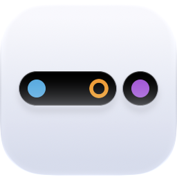

<p align="center">
  <picture>
    <source media="(prefers-color-scheme: dark)" srcset="docs/logo/logo-dark.png">
    
  </picture>
</p>

# Skellige

**Test how your app's Live Activity competes for the Dynamic Island.** Skellige installs up to three dummy helper apps on an iPhone Simulator, and each one runs its own Live Activity. Start your app's activity, add 1–3 rivals, and watch what iOS shows.

```sh
npx skellige
```

Pick a Simulator, pick 1, 2, or 3 helper apps, then open each helper and tap **Activate Live Activity**. Tap again to stop.

Needs macOS with full Xcode, an installed iOS 17+ Simulator runtime, Node.js 18+, and an iPhone model with a Dynamic Island. Nothing is signed and no Apple Developer account is needed. Tested on Xcode 27.0 with iOS 27.0 Simulators; other versions and physical devices are untested.

## Run it from scripts and agents

Every command also works with flags and no prompts. `npx skellige --help` prints the full reference.

```sh
npx -y skellige doctor                                   # booted iPhone UDIDs
npx -y skellige install --competitors 3 --device <udid>  # install helpers only
npx -y skellige start   --competitors 3 --device <udid> --return-to <bundle-id>
npx -y skellige status  --device <udid> --return-to <bundle-id>
npx -y skellige stop    --device <udid> --return-to <bundle-id>
```

- `start` starts Live Activities in the first N helpers without anyone touching the Simulator. It runs Apple's Shortcuts app through an XCUITest runner, then reopens `--return-to`. Running it again does not add duplicates, and a lower N stops the extra helpers.
- `stop` ends every Skellige activity and leaves your app's activity alone.
- `--return-to` must be installed on that Simulator. Pass your app's bundle ID, or `com.apple.mobilesafari` if you don't have one.
- `--device` can be omitted for `start`, `status`, and `stop` when exactly one iPhone is booted. `install` boots a stopped Simulator; the others need it booted. `xcrun simctl list devices available` lists every UDID.
- `start`, `status`, and `stop` take about a minute or more each. The first run also builds the Swift CLI and the helpers.
- Exit code 0 means success, 1 means an error (the message goes to stderr), and 130 means cancelled.

## Interactive setup

`npx skellige` without a command lists Simulators in this order: **running**, **existing but stopped** (setup boots it), and **new** (setup creates `Skellige <model>` from a runtime you already have). Each entry shows its iOS version. Nothing is created or booted until you also confirm the helper count. To add an iOS version, [install its runtime in Xcode](https://developer.apple.com/documentation/xcode/downloading-and-installing-additional-xcode-components).

Move with **↑/↓** or **J/K** and press **Enter** to choose. **Esc** goes back, **Q** or **Ctrl+C** cancels. Piped input and `TERM=dumb` get numbered prompts instead.

The helper apps are **An Craite**, **Tordarroch**, and **Drummond**. Each keeps one activity. They stay installed until you remove them from the Simulator.

## What the counts mean

`status` invokes a new App Intent in each helper and reports its ActivityKit count. It cannot count your app's activities. Multiple active activities do not guarantee the same number of simultaneous compact Island items; iOS chooses what to show. On an iPhone 18 Pro Simulator with iOS 27.0, Activity Lab 3 plus two helpers were all active, while the settled Island accessibility view exposed two minimal items. The second helper's widget appeared after the first ended. See [the system findings](docs/stage-3-findings.md).

The dummy widgets show a 20-minute countdown. That display deadline does not automatically end an activity while no command runs. Call `stop` when the test is over. A later command also prunes expired Skellige activities.

## Development

From a source checkout, `swift run skellige <command>` takes the same arguments as `npx skellige`.

```sh
swift test
```

To check arrow selection, cancellation, terminal restoration, and piped numeric input through the CLI:

```sh
swift build
PYTHONDONTWRITEBYTECODE=1 python3 -m unittest discover -s Tests/CLI -v
```

These terminal tests require a booted eligible iPhone Simulator; the Simulator picker test requires two. They exit before installation and leave the Simulators unchanged.

The [execution plan](docs/execution-plan.md) records the stack, tested paths, and release work that remains. The host code is in `Sources/`, the three native helper builds are in `ios/Competitor.xcodeproj`, and the Shortcuts UI driver is in `ios/ShortcutDriver.xcodeproj`.

The npm package contains these sources and a small Node launcher that runs `swift run`. To inspect what a release would ship, run `npm pack --dry-run`.

## Easter eggs

> **Spoiler warning.** This section explains the jokes.

### Why Skellige

Skellige is an island chain in Andrzej Sapkowski's *The Witcher*. Its clans share the islands and keep fighting over one throne. Live Activities do the same in the Dynamic Island: several apps, one small island, and iOS decides who gets seen.

### The clans

The three helper apps are An Craite, Tordarroch, and Drummond, all Skellige clans. Your own app is the outsider who sailed in to see how it fares against them.

### The contested throne

When `start` or `status` finds all three clans with an active Live Activity, it adds one line: "The Skellige throne is contested."

Skellige and its clans come from *The Witcher* by Andrzej Sapkowski. This project is not affiliated with him or with CD PROJEKT.

## License

[MIT](LICENSE). Skellige's code and widget designs are original to this repository; the Gymrat Activity Lab served only as a reference test app.
